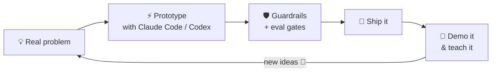

<div align="center">


<p>
  <a href="https://www.linkedin.com/in/rongjiwang"></a>
  <a href="mailto:rongjiwang0312@gmail.com"></a>
  
</p>

</div>

I'm a platform engineer who fell **head over heels for AI agents** 🤖💜, and I can't stop telling people about it.

By day I bring AI into a place where *"move fast and break things"* is not an option: a top-tier law firm, where every agent needs guardrails, every change needs evidence and every action needs an audit trail. By night I'm tinkering with agent teams, MCP servers and eval harnesses, then trying to convince everyone around me to give them a go. 😄

My favourite thing? Showing a skeptical engineer that AI can be **safe, useful and genuinely fun** at the same time.

## 🎬 A good day at the terminal

<div align="center">
  
</div>

## 💜 Why I'm all-in on AI

- 🚀 **Agents are the biggest shift in how we build software since the cloud.** I want to help teams ride that wave, not get flattened by it.
- 🛡️ **Safety makes AI faster, not slower.** Guardrails, eval gates and least privilege are what let you say *yes* to AI in serious places.
- 🧑‍⚖️ **Humans stay in charge.** Agents are read-only by default, propose the change, and a person approves it. Autonomy is earned, one step at a time.
- 📜 **Docs beat chat history.** Durable plans and decisions in the repo make agents (and people) far better at picking up where they left off.
- 🎉 **It should be fun.** If adopting AI feels like paperwork, we're doing it wrong.

## 🔁 My favourite loop



## 📣 How I spread the AI love

| | |
|---|---|
| 🏢 **AI at work** | Led my firm's enterprise AI rollout: Claude on Amazon Bedrock for every staff member, with identity, usage controls and audit logging built in. |
| 🚨 **An AI on-call buddy** | Wired AWS DevOps Agent into production alerting, so incidents get investigated before a human has finished their coffee. |
| 🎭 **Agent team demos** | Built a five-agent "platform team" (ops lead, architect, delivery, security, FinOps) and demoed it to the CTO and leadership. The delivery agent can open PRs, but it can't merge them. Trust is earned! |
| ✅ **Making AI-written code trustworthy** | Introduced eval gates so AI-assisted infrastructure changes bring the same tests, policy checks and evidence as human ones. |
| 🌱 **Open source** | Writing agent skills and curating lists so others can get started faster (see below). |

## 🔭 My open-source playground

| Project | What it is |
|---|---|
| 📚 [**document-driven-autonomy**](https://github.com/rongjiwang/document-driven-autonomy) | A Codex skill that lets agents carry long engineering work forward from repo docs instead of the latest chat turn. |
| 🦞 [**awesome-openclaw-skills**](https://github.com/rongjiwang/awesome-openclaw-skills) | A curated index of OpenClaw skills. Come find your next favourite. |
| 🌍 [**worldmonitor**](https://github.com/rongjiwang/worldmonitor) | An AI-powered global intelligence dashboard for news, geopolitics and infrastructure. |

## 🧪 Currently tinkering with

```diff
+ 🔌 MCP servers with real guardrails (and evals that catch made-up numbers)
+ 🤖 multi-agent teams where autonomy grows with observed performance
+ 🧪 eval harnesses that grade agent trajectories, not just final answers
+ 🔍 AI code review that never lets your code leave the country
- 😴 manually gathering evidence at 3am during an incident
```

## 🛠️ Toys in my toolbox

<p align="center">
  
</p>
<p align="center">
  
  
  
  
  
</p>

## 🎲 Random facts

- 🇳🇿 ➡️ 🇦🇺 Kiwi-trained, now building in Sydney.
- 🎓 Collected 8 certifications (6 of them AWS), and I *still* read the docs.
- 💸 Cut a cloud bill by 28%. FinOps is my cardio.
- 🤖 My agents have opened more PRs than some of my friends. I review every single one.

## 🤝 Come nerd out with me

Want to swap agent war stories, compare MCP servers, or figure out how to get AI past your security team? **[I'm always up for a chat](https://www.linkedin.com/in/rongjiwang).** ☕


