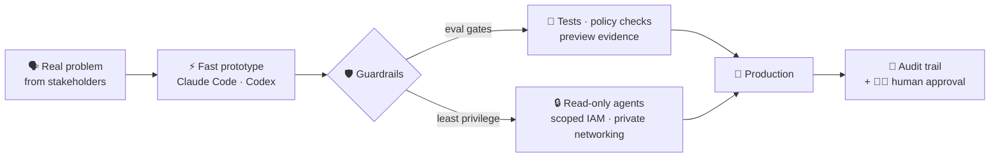

<div align="center">

# Hey, I'm Rongji (Kevin) Wang 👋

<a href="https://github.com/rongjiwang">
  
</a>

<p>
  <a href="https://www.linkedin.com/in/rongjiwang"></a>
  <a href="https://www.credly.com/users/rongji-wang"></a>
  <a href="mailto:rongjiwang0312@gmail.com"></a>
  
</p>

</div>

I take AI from *"a stakeholder has a problem"* to *"it's running in production and the auditors are happy."* I scope with business and security teams, prototype fast with Claude Code and Codex, then ship agentic workflows into regulated environments with **guardrails, evaluation gates and audit trails built in.**

```yaml
whoami:
  role:      Staff Platform Engineer · AI Platform & Agentic Workflows
  now:       leading AI enablement at a top-tier Australian law firm
  before:    8+ years across consulting (banking, health, government) and SaaS
  stack:     [Python, TypeScript, Pulumi, Terraform, AWS, Kubernetes]
  motto:     "Read-only by default. Humans approve every change."
```

## 🧭 How I ship AI without scaring the security team



## 🏆 Highlights

| | |
|---|---|
| 🤖 **Enterprise AI, done safely** | Designed the governed Amazon Bedrock integration behind a firm-wide AI assistant: Claude for every staff member, with central identity, usage controls and audit logging. |
| 🚨 **An AI on-call buddy** | Wired AWS DevOps Agent into production alerting so EKS incidents get investigated automatically: cross-account intake, allowlisted triggers, signed webhooks, idempotency, sanitised findings. |
| 🧩 **MCP agents in ops** | Read-only MCP agents for security incident response, FinOps investigation and EKS upgrade validation. |
| ✅ **Eval gates for AI-written infra** | Each type of AI-assisted change gets matched to the tests, policy checks and preview evidence it needs before a human reviews it. |
| 💸 **28% cloud cost cut** | FinOps practice: Savings Plans, rightsizing, decommissioning and spend ownership. |
| 🏦 **Days → hours** | HIPAA-aligned landing zone that cut health-agency onboarding from days to hours; serverless ATM data platform for a major bank. |

## 🛠️ Toolbox

<p align="center">
  <br/>
  
</p>

<p align="center">
  
  
  
  
  
  
</p>

## 🔭 Things I've built in the open

| Project | What it does |
|---|---|
| 📚 [**document-driven-autonomy**](https://github.com/rongjiwang/document-driven-autonomy) | A Codex skill that lets an agent continue long engineering work from durable repo docs instead of the latest chat turn: assess readiness, find the plan, do the next task, verify, checkpoint. |
| 🦞 [**awesome-openclaw-skills**](https://github.com/rongjiwang/awesome-openclaw-skills) | A curated index of OpenClaw skills. |
| 🌍 [**worldmonitor**](https://github.com/rongjiwang/worldmonitor) | AI-powered global intelligence dashboard for news, geopolitical and infrastructure monitoring. |

**🧪 R&D: an agentic SDLC team.** Five role-based agents (ops lead, architect, delivery engineer, security & reliability, FinOps), with role boundaries enforced in code and autonomy that grows only with observed performance. The delivery agent can open PRs but can't merge. I still review every one. 😄

<details>
<summary><b>🗺️ The road so far</b> (click to expand)</summary>
<br/>

| When | Where | What |
|---|---|---|
| 2024 → now | **Gilbert + Tobin** · Sydney | Staff Platform Engineer: AI enablement, landing zone modernisation, ISO 27001 readiness, FinOps |
| 2021 → 2024 | **Datacom** · Wellington | Cloud Platform Specialist: banking, health-tech and government platforms, SRE for major clients |
| 2020 → 2021 | **Xero** · Wellington | Site Reliability Engineer: Terraform monitoring standards, incident management |
| 2017 → 2020 | **Assurity Consulting** · Wellington | Software / DevOps Engineer, Java/Scala Dev Lead: MuleSoft X12 streaming (100× scale), AS2 connector |
| 2015 → 2017 | **Victoria University of Wellington** | B.Sc. Computer Science & Engineering |

</details>

<details>
<summary><b>🎖️ Certifications</b> (click to expand)</summary>
<br/>

- AWS Certified **Solutions Architect – Professional**
- AWS Certified **DevOps Engineer – Professional**
- AWS Certified **Security – Specialty**
- AWS Certified SysOps Administrator, Developer and Solutions Architect – Associate
- HashiCorp Certified **Terraform Associate (003)**
- Professional Scrum Master I

Verify them on [Credly](https://www.credly.com/users/rongji-wang).

</details>

## 🤝 Let's talk about

- 🤖 agent skills, MCP servers and multi-agent workflows that are safe enough for production
- 🛡️ guardrails, eval gates and human-in-the-loop design for AI in regulated industries
- ☁️ AWS platforms, landing zones and IaC that people actually enjoy working with
- 💸 making the cloud bill smaller

<div align="center">

**If your agents need a grown-up in the room, [let's chat](https://www.linkedin.com/in/rongjiwang).** ☕

</div>
