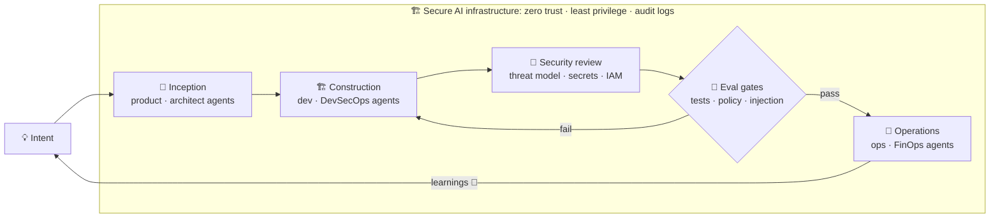

<div align="center">



<p>
  <a href="https://www.linkedin.com/in/rongjiwang"></a>
  <a href="mailto:rongjiwang0312@gmail.com"></a>
  
</p>

</div>

I'm a platform engineer who fell **head over heels for AI agents** 🤖💜, and I can't stop telling people about it.

My big obsession: **software that builds itself.** You describe the intent, and a team of agents plans it, builds it, secures it, tests it and ships it, on AI infrastructure solid enough to trust with production. I do this in a place where *"move fast and break things"* is not an option (a top-tier law firm), so **security is never an afterthought**: every agent ships with least privilege, guardrails, evidence and an audit trail. 😄

## 🎯 Current focus

<table>
<tr>
<td width="50%" valign="top">

### 🏗️ AI infrastructure
The platform underneath the magic: governed model access on Amazon Bedrock, MCP servers, identity, usage controls, observability and audit logging, all as code.

</td>
<td width="50%" valign="top">

### 🤖 Fully autonomous agent workflows
Agent teams that take work end to end without a human babysitting every step, kept safe by role boundaries, eval gates and autonomy that grows with proven performance.

</td>
</tr>
<tr>
<td width="50%" valign="top">

### 🔁 AI-DLC
The AI-Driven Development Lifecycle: specialised agents for product, architecture, development, DevSecOps, compliance, quality and operations, taking an intent from inception through construction to production.

</td>
<td width="50%" valign="top">

### 🔐 Security, built in
The non-negotiable that makes the other three possible: zero trust, least privilege, data residency, prompt-injection defence and a full audit trail, designed in from day one.

</td>
</tr>
</table>

## 🔐 Security is the whole point

The more autonomy an agent has, the more its security matters. Here's how I make autonomous AI safe enough for a law firm:

| | |
|---|---|
| 🔑 **Least privilege, always** | Agents start read-only with narrowly scoped IAM. Write access is earned and tightly scoped, and a human approves anything that changes production. |
| 🧱 **Zero trust plumbing** | Private networking, identity federation (IAM Identity Center + Entra ID), signed webhooks, allowlisted triggers and OIDC instead of stored secrets. |
| 🌏 **Data stays where it belongs** | Region-pinned model inference, sensitive payload logging off by default, and findings sanitised before they leave the boundary. |
| 💉 **Prompt-injection aware** | Eval suites include injection cases, and agent tools validate inputs and refuse out-of-scope or write requests. |
| 🧪 **Policy as code** | Every change, human- or AI-written, passes tests, policy checks and preview evidence before it ships. |
| 📜 **Audit everything** | Model invocation logging, immutable deploys and full agent trajectories, so we can always answer *"who did what, and why?"* |
| 🏛️ **Compliance-ready** | ISO 27001 readiness, CIS benchmarks and AWS Well-Architected reviews, backed by an AWS Security – Specialty certification. |

## 🎬 An AI-DLC run, start to finish

<div align="center">
  
</div>

## 💜 Why I'm all-in on AI

- 🚀 **Agents are the biggest shift in how we build software since the cloud.** I want to help teams ride that wave, not get flattened by it.
- 🔐 **Security is what unlocks autonomy.** You can only hand agents real power once least privilege, guardrails, eval gates and audit trails are in place. Secure AI is *fast* AI.
- 🤖 **Full autonomy is the goal, and it's earned.** Agents start read-only, prove themselves on evals, and gain more freedom step by step. Humans set the intent and the rules; agents do the work.
- 📜 **Docs beat chat history.** Durable plans and decisions in the repo make agents (and people) far better at picking up where they left off.
- 🎉 **It should be fun.** If adopting AI feels like paperwork, we're doing it wrong.

## 🔁 AI-DLC, the way I run it



## 📣 How I spread the AI love

| | |
|---|---|
| 🏢 **AI at work** | Led my firm's enterprise AI rollout: Claude on Amazon Bedrock for every staff member, with identity, usage controls and audit logging built in. |
| 🚨 **An AI on-call buddy** | Wired AWS DevOps Agent into production alerting, so incidents get investigated before a human has finished their coffee. |
| 🔁 **AI-DLC in practice** | Built a 14-role AI-DLC agent workflow (product, architecture, development, DevSecOps, compliance, quality, operations) that takes infrastructure intents from inception through construction. |
| 🎭 **Agent team demos** | Built a five-agent "platform team" (ops lead, architect, delivery, security, FinOps) and demoed it to the CTO and leadership. The delivery agent can open PRs, but it can't merge them. Trust is earned! |
| ✅ **Making AI-written code trustworthy** | Introduced eval gates so AI-assisted infrastructure changes bring the same tests, policy checks and evidence as human ones. |
| 🌱 **Open source** | Writing agent skills so others can run autonomous engineering work safely (see below). |

## 🌟 Featured project

### 📚 [document-driven-autonomy](https://github.com/rongjiwang/document-driven-autonomy)

A Codex skill for **long-running autonomous engineering**. Instead of relying on the latest chat turn, the agent works from durable repo docs: it checks whether the repo is ready for autonomy, finds the plan, picks up the next task, verifies the work and checkpoints progress. Open source, MIT licensed and validated in CI.

[](https://github.com/rongjiwang/document-driven-autonomy/releases/latest)

## 🧪 Currently tinkering with

```diff
+ 🤖 fully autonomous agent workflows, from intent to production
+ 🔁 AI-DLC agent teams with clear roles and enforced boundaries
+ 🏗️ AI infrastructure: governed model access, MCP servers, audit trails
+ 🔐 security agents that threat-model every change before it ships
+ 💉 red-teaming my own agents with prompt-injection eval suites
+ 🧪 eval harnesses that grade agent trajectories, not just final answers
- 😴 humans copy-pasting between tickets, terminals and dashboards
```

## 🛠️ Toys in my toolbox

<p align="center">
  
</p>
<p align="center">
  
  
  
  
  
  
  
</p>

## 🎲 Random facts

- 🇳🇿 ➡️ 🇦🇺 Kiwi-trained, now building in Sydney.
- 🎓 Collected 8 certifications (including AWS Security – Specialty), and I *still* read the docs.
- 🔐 My favourite word in any agent design review: *"least privilege"*.
- 💸 Cut a cloud bill by 28%. FinOps is my cardio.
- 🤖 My agents have opened more PRs than some of my friends. I review every single one.

## 🤝 Come nerd out with me

Building AI infrastructure, autonomous agents or an AI-DLC of your own? Want to swap agent war stories or figure out how to get autonomous AI *through* your security team, not around it? **[I'm always up for a chat](https://www.linkedin.com/in/rongjiwang).** ☕


